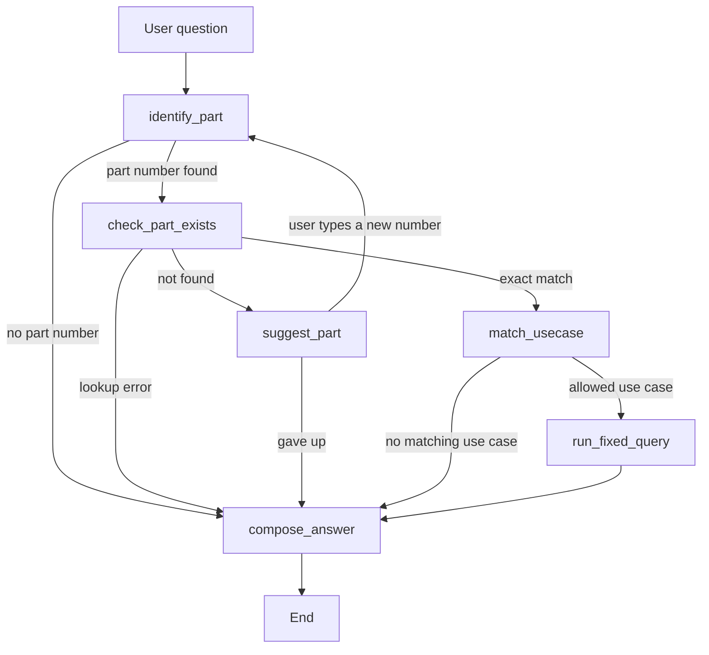

# Databricks BOM Agent

A Python agent that answers a fixed set of Bill of Materials questions from Databricks. The model reads the question. The warehouse decides whether the part number is real, what kind of part it is, and what the rows say.

## Workflow



1. `identify_part` copies the part number exactly as written and guesses assembly, component (purchased part), or model (product). It does not correct typos. A number the user did not write is rejected.
2. `check_part_exists` looks up that exact number in the item master. The row sets the part type. A wrong guess does not send a real number down the typo path. Several types for one number stop the run.
3. When the number is missing, `suggest_part` asks the vector index for the closest part numbers and tells the user to type the number again. That reply goes back to `identify_part`. After three misses the graph stops. The original question is kept, so the use-case match still sees what the user asked.
4. `match_usecase` picks one pre-written query allowed for the confirmed type.
5. `run_fixed_query` runs that SELECT with the part number bound as a parameter.
6. `compose_answer` phrases the rows. Errors and "please retype" messages skip the model.

| Confirmed type | Fixed queries |
| --- | --- |
| model | BOM explosion, customer impact, model impact |
| component | component impact, supplier impact |
| assembly | recognized and looked up; no fixed query yet |

A model question cannot run a component query. The allowed list is in `AgentState` (`USECASES_BY_PART_TYPE`), and `run_fixed_query` checks it again before executing.

The earlier nodes (`intent_router`, `databricks_query`, `response_generation`) are still in the tree. The compiled graph no longer calls them.

## What you still wire in

The graph shape is in place. These three slots are empty on purpose:

| Slot | File | What to set |
| --- | --- | --- |
| Item master | `src/databricks_agent/agent/nodes/check_part_exists.py` | `ITEM_TABLE`, `ITEM_ID_COLUMN`, `ITEM_TYPE_COLUMN`. Type values must be assembly, component, or model. |
| Vector index | `src/databricks_agent/agent/nodes/suggest_part.py` | `VECTOR_INDEX`, and the body of `search_similar_parts`. Until then the node asks for a retype with no suggestion. |
| Fixed SQL | `src/databricks_agent/agent/nodes/run_fixed_query.py` | `FIXED_QUERIES`. Each value is a read-only SELECT with one `?` for the part number. |

`identify_part`, `match_usecase`, and `compose_answer` call `create_chat_model()`, which is not implemented yet. `src/databricks_agent/integrations/databricks/llm.py` is still a standalone script.

During one question, `suggest_part` reads the next part number with `input()`. The CLI loop in `main.py` does not need a second invoke for that retry. The `databricks-agent` command still points at the placeholder in `src/databricks_agent/__init__.py`. Run the real loop with:

```bash
uv run python -m databricks_agent.main
```

## Setup

Python 3.14 or newer, uv, a Databricks workspace, and a SQL warehouse. The identity needs read access only to the catalog and schema this agent uses.

```bash
uv sync
cp .env.example .env
```

| Variable | Purpose |
| --- | --- |
| `DATABRICKS_HOST` | Workspace URL |
| `DATABRICKS_TOKEN` | Access token |
| `DATABRICKS_HTTP_PATH` | SQL warehouse HTTP path |
| `DATABRICKS_CATALOG` | Catalog of the item master and BOM tables |
| `DATABRICKS_SCHEMA` | Schema of those tables |
| `DATABRICKS_LLM_ENDPOINT` | Model-serving endpoint |

Do not commit `.env` or put credentials in source code.

The SQL client rejects anything that is not a single read-style statement. The fixed queries are trusted code that you paste in; the model never writes SQL.

```bash
uv run pytest
uv run ruff check .
```

Tests are not written yet.

## Roadmap

- Point `create_chat_model()` at the configured serving endpoint.
- Confirm the item-master names and paste the five SELECT statements.
- Connect `search_similar_parts` to the vector index.
- Point the `databricks-agent` script at `databricks_agent.main`.
- Add tests for routing, the existence lookup, and the use-case allow-list.
- Decide which fixed queries an assembly should run.
